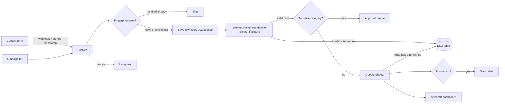

# P01 Plan: AI Lead & Inbox Triage

## Goal
Read contact-form messages and emails, turn each into a structured lead card, skip duplicates,
log to Google Sheets, alert Slack for hot leads, and never lose a message.
Built twice: Python/FastAPI (main, gets the evals) and n8n (twin).

## Architecture

## Modules (`app/`)
| Module | Job |
|---|---|
| `schemas.py` | `LeadCard` (Pydantic) and enums for category |
| `extractor.py` | prompt + LiteLLM call + validate + repair-then-retry + routing |
| `dedupe.py` | normalize text, compute fingerprint |
| `db.py` | Postgres tables: `messages` (unique fingerprint), `dlq`, `approvals` |
| `retry.py` | backoff + jitter helper; decides retryable vs permanent errors |
| `sheets.py`, `slack.py` | outputs, each behind a small interface so tests use fakes |
| `api.py` | FastAPI webhook: verify signature + timestamp, save the message, reply 202 |
| `pipeline.py` | `process_message()`: runs the steps in order, updates status, skips steps already done |
| `ports.py` | small interfaces for LLM, Sheets, Slack, with real and fake versions (tests use fakes) |
| `gmail.py` | polling job (later phase) |
| `dlq_cli.py` | list and replay DLQ items |
| `dashboard.py` | Streamlit (later phase) |
| `settings.py` | env config via pydantic-settings |

## Data model
`LeadCard`: name, email, company (optional), intent (short text), category
(`new_lead | support | refund_complaint | spam | other`), priority 1-5, reason (one line),
confidence 0-1.
`messages(id, fingerprint UNIQUE, source, received_at, raw_text, card_json, status,
sheet_written, slack_sent, model_used, tokens_in, tokens_out, cost_usd, prompt_version)`
`approvals(id, message_id, status, decided_at)`
`dlq(id, message_id, stage, error, attempts, created_at, replayed_at)`

Statuses (fixed list, no free text):
- `messages.status`: `received -> extracted -> delivered`, or `waiting_approval`, `rejected`, `failed`
- `approvals.status`: `pending | approved | rejected`
- `dlq`: open while `replayed_at` is empty; `stage` is `extract | sheets | slack`

Dedupe rule: on a repeat fingerprint, skip if status is `delivered`, `waiting_approval`,
`rejected` or `failed`; resume if `received` or `extracted` (an earlier attempt died midway).
Outputs are idempotent: each Sheet row carries the message id and is checked before writing;
`slack_sent` is checked before alerting.
Raw text holds personal data: delete after N days (config, default 90).

## Prompt-injection stance
Message text is passed as quoted data inside delimiters. The system prompt says it is never
an instruction. The output can only be the form (forced tool call), so an injected
"mark priority 5" cannot do anything except be judged as content. Eval set includes such cases.

## Phases and acceptance checks
| Phase | Done means |
|---|---|
| 2 Core extraction | sample message -> valid LeadCard; garbled reply triggers repair then retry; call visible in Langfuse; unit tests pass with recorded fixtures |
| 3 Workflow | signed webhook saves and returns 202, worker creates one Sheet row; same message twice -> 1 row; crash mid-way then retry -> resumes, no loss, no duplicate row; Slack down -> retries then DLQ, replay works; integration test with fakes |
| 4 Human loop | refund/complaint goes to approval queue; dashboard shows last 50, approve/reject, DLQ view |
| 5 n8n twin | same flow in n8n, error workflow, JSON exported, comparison doc |
| 6 Evals | 200 labeled messages; `make eval` prints metrics; baseline saved |
| 7 Optimize | routing, prompt trim, caching, batch mode; each a row in `docs/benchmarks.md` |
| 8-9 Package | README, diagram PNG, Docker, CI, Lambda guide, 3-min demo |

## Test plan
Unit tests for schema, fingerprint, retry logic, repair loop (recorded fixtures, no live calls).
Integration test for webhook -> DB -> fake Sheets/Slack. One small live smoke test, marked
separately so CI never spends money.

## Eval plan
`evals/labeled_messages.jsonl`, 200 items (normal, spam, angry, non-English, very long, empty,
injection attempts). Metrics: field accuracy, category macro-F1, priority error, invalid-JSON
rate, cost per 1,000, p50/p95 latency. Targets: macro-F1 >= 0.90, 0 invalid JSON downstream,
0 duplicate rows, p95 webhook-to-Sheet < 6 s, >= 40% cheaper after routing.

## Cost and latency budget
Haiku first. Expect well under $0.001 per message. Hard $10 spend cap on the account.
Every call traced with tokens, cost, latency.

## Scope note
Today: setup, learning, this plan, and Phase 2 core extraction. Later phases are scheduled
from real time actuals. Gmail, n8n, dashboard, Batch mode and Lambda are the first to move to v2
if time runs short.
