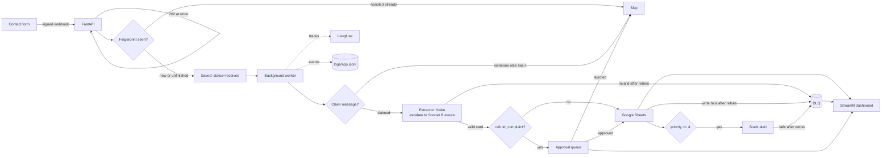

# AI Lead & Inbox Triage — 96.7% accurate lead sorting, $2.63 per 1,000 messages

Reads contact-form and email messages, has an LLM extract who's writing and how urgent it is,
skips duplicates, logs everything to Google Sheets, and pings Slack only for the hot leads —
without ever losing a message, even when Sheets, Slack, or the AI itself is down.

▶ Demo video: _coming soon_

## Problem

A small consultancy owner reads every contact-form message and email by hand. Buried among
routine enquiries and spam are the leads worth thousands of dollars — and a naive automation
(a bad AI response, a Slack outage, a double-submitted form) can silently drop one, or worse,
create duplicates and false alarms that train the owner to ignore alerts altogether.

## Solution



**Three decisions worth explaining on a client call:**
1. **Save first, reply 202, process after** ([ADR 006](docs/adr/006-save-first-process-after.md)) —
   a message is safe in the database the instant it arrives, even if the AI or Google is down.
2. **Per-message claim locking** ([ADR 003](docs/adr/003-dedupe-idempotency.md)) — a duplicate
   submission arriving while the first is still processing is turned away, not double-billed
   and double-alerted.
3. **Model routing, honestly measured** ([ADR 007](docs/adr/007-cost-optimization.md)) — we
   tried routing to cut cost by 40% as planned; the eval proved it didn't, and prompt trimming
   did instead. Both the attempt and the honest result are on record.

## Results

Eval set: 60 AI-generated, hand-reviewed messages (`evals/labeled_messages.jsonl`), covering
normal enquiries, spam, angry complaints, non-English text, very long messages, empty input,
and prompt-injection attempts.

| N | Category accuracy | Macro-F1 | Priority MAE | Invalid/failed | Cost / 1,000 | p50 latency | p95 latency | Config |
|---|---|---|---|---|---|---|---|---|
| 60 | 96.7% | 0.878 | 0.47 | 0.0% | $2.26 | 1.99s | 2.67s | Haiku, prompt v1 (baseline) |
| 60 | 96.7% | 0.878 | **0.28** | 0.0% | $2.63 | 2.06s | 4.12s | Haiku+routing, prompt v4 (final) |

**Final config vs. baseline:** same category accuracy, **40% less priority error**, **company
hallucination eliminated (6/60 → 0/60)**, at a 16% cost increase — a deliberate quality-for-cost
trade, not the pure cost win originally planned. Full experiment log, including two optimizations
that were tried and honestly found *not* to help (routing alone, and prompt caching below
Anthropic's minimum cacheable size), is in [`docs/benchmarks.md`](docs/benchmarks.md) and
[ADR 007](docs/adr/007-cost-optimization.md).

p95 latency (webhook → Sheet row) target was < 6s; achieved 2.6–4.1s across all configs tested.

## Key design decisions

| ADR | Decision |
|---|---|
| [001](docs/adr/001-n8n-vs-python.md) | n8n vs Python — build both, compare |
| [002](docs/adr/002-structured-output.md) | Forced tool call + Pydantic validation, repair-then-retry |
| [003](docs/adr/003-dedupe-idempotency.md) | SHA-256 fingerprint, unique constraint, resume-not-skip on crash |
| [004](docs/adr/004-failure-handling.md) | Bounded retries + backoff/jitter, idempotent outputs, DLQ |
| [005](docs/adr/005-model-routing.md) | Confidence-based escalation policy |
| [006](docs/adr/006-save-first-process-after.md) | Signed webhook saves and replies 202 before any AI call |
| [007](docs/adr/007-cost-optimization.md) | What actually cut cost, and what didn't |

## Reliability & safety

- **Prompt injection:** message text is wrapped in `<message>` tags and the system prompt
  explicitly treats it as untrusted data — verified in the eval set and unit tests.
- **Idempotent everywhere it matters:** Sheet rows carry the message id and are checked before
  writing (with a write lock + `INSERT_ROWS`, since parallel workers write to one shared Sheet);
  Slack alerts check a `slack_sent` flag first.
- **Never silently loses a message:** every failure (extraction, Sheets, Slack) ends up as a row
  in the `dlq` table with the reason and attempt count, replayable via `app.dlq_cli`.
- **Human in the loop:** refund/complaint messages are held for approval and never auto-delivered.
- **Secrets:** `.env` and `secrets/` (the Google service-account key) are git-ignored; never commit them.
- **Structured logs:** every meaningful event (`signature_rejected`, `message_extracted`,
  `claim_missed`, `dlq_replayed`, ...) is a JSON line in `logs/app.jsonl`, rotated at 5MB.

## Quick start

```bash
git clone <this repo> && cd p01-ai-lead-triage
cp .env.example .env   # fill in: Anthropic key, Langfuse keys, webhook secret, Google/Slack config
docker compose up -d   # Postgres
uv sync
uv run pytest -q       # 135 tests

uv run uvicorn app.api:app --port 8000        # the webhook + worker
uv run streamlit run app/dashboard.py         # approvals / messages / DLQ, password from .env
uv run python -m app.dlq_cli list             # inspect the dead-letter shelf
uv run python -m evals.run_eval               # re-run the eval, appends a benchmarks.md row
```

## Limitations / what I'd do next

- **IDs must never be reset once downstream systems hold data.** Google Sheets' own dedupe key
  is the message id; a database `TRUNCATE` that restarts the id sequence will silently skip
  writing a row whose id was already used by old Sheet data (found live during testing).
- **Docker's logs/ bind mount was removed on purpose.** The container runs as root, so a bind-mounted logs/ folder ends up root-owned on the host - a local (non-Docker) `uv run` can then no longer write to it. Found live while testing; the container keeps its own internal logs for v1 instead.
- **The Sheets write lock only works within one process.** Multiple server instances would need
  per-process log files/a central log collector and a different Sheets-write coordination
  mechanism than an in-process `threading.Lock`.
- **Batch API was deliberately not built** — it only suits non-urgent bulk reprocessing (client
  onboarding, backlog catch-up), never the live inbox, since a message's priority is only known
  *after* extraction. See [ADR 007](docs/adr/007-cost-optimization.md).
- **v2 (not yet built):** Gmail polling, the n8n twin workflow, AWS Lambda deployment.
- **Langfuse's free tier caps at 50k units/month** — fine for this scale, worth flagging to a
  client running high volume.
